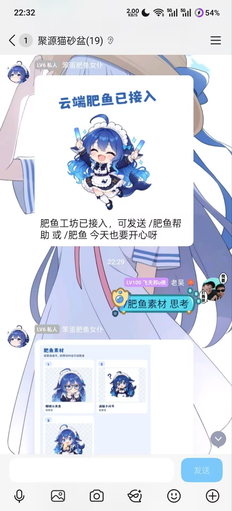
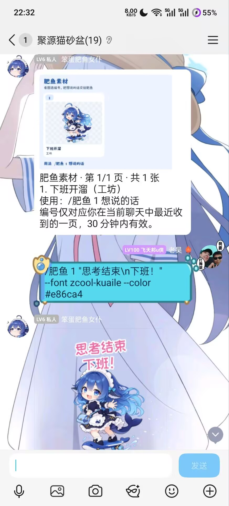
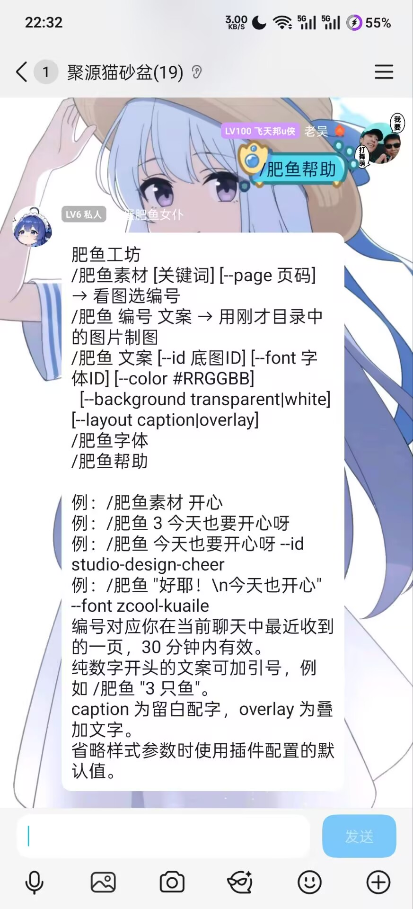

# 肥鱼工坊 · AstrBot 插件

<p align="center">
  
</p>

先看缩略图目录，再用编号和文案制作表情包。机器人调用 [肥鱼工坊](https://github.com/Eynnzerr/blue-fish-studio) 图片服务，回复一张 1024 × 1024 PNG 图片；支持选择字体、文字颜色、画布背景和排版。

```text
/肥鱼素材 开心
/肥鱼 3 今天也要开心呀
```

## 使用效果

QQ 群聊中的实际效果，点击图片可查看大图。

<table>
  <tr>
    <th>素材查询</th>
    <th>按编号制图</th>
  </tr>
  <tr>
    <td align="center">
      <a href="docs/images/qq-sticker-search.jpg"></a>
    </td>
    <td align="center">
      <a href="docs/images/qq-numbered-render.jpg"></a>
    </td>
  </tr>
  <tr>
    <th>自定义字体与配色</th>
    <th>命令帮助</th>
  </tr>
  <tr>
    <td align="center">
      <a href="docs/images/qq-custom-style.jpg"></a>
    </td>
    <td align="center">
      <a href="docs/images/qq-command-help.jpg"></a>
    </td>
  </tr>
</table>

## 第一次使用

1. 发送 `/肥鱼素材`，机器人回复一页带编号的缩略图；也可以发送 `/肥鱼素材 开心` 按关键词查找。
2. 看中第 3 张，发送 `/肥鱼 3 今天也要开心呀`，即可收到配好文案的 PNG。
3. 想换风格，可以发送 `/肥鱼 3 今天也要开心呀 --font zcool-kuaile --color #e86ca4`。

每页最多 8 张，翻页时按机器人给出的下一页命令操作。编号对应你在当前聊天中最近收到的一页，30 分钟内有效；群友的查询各自独立。插件重载后重新查询即可。

不选图时，`/肥鱼 今天也要开心呀` 使用默认底图。想让文案本身以数字开头，可加引号：`/肥鱼 "3 只鱼一起摸鱼"`。

## 安装与配置

运行环境：Python 3.10+、AstrBot 4.28.2+。

默认图片服务为 `https://eynnzerr.cloud/blue-fish`，已上线，供安装本插件的 QQ Bot 使用。使用默认服务时无需 API Key，安装后即可使用。

在 AstrBot WebUI 的插件管理中，使用以下仓库地址安装：

```text
https://github.com/Eynnzerr/astrbot_plugin_blue_fish
```

也可使用本地 ZIP 上传功能。将本目录内容打包，确保 ZIP 根目录包含 `main.py`、`metadata.yaml`、`_conf_schema.json` 和 `requirements.txt`；或将完整插件目录复制到 `AstrBot/data/plugins/astrbot_plugin_blue_fish`，在 AstrBot 使用的 Python 环境中安装 `requirements.txt`，然后重启或重载插件。

默认配置中 `api_key` 留空。服务按机器人所在服务器的出口 IP 限流，同一出口 IP 的机器人和聊天共享额度；遇到请求频繁或服务繁忙的提示时，稍候重试。

图片服务接收文案和样式参数，在内存中即时合成并返回 PNG，不保存文案或生成图片。

升级保留已有的 `api_url` 和 `api_key` 配置。切换到默认图片服务时，将地址改为上述 URL，未获得单独调用凭证时将 API Key 留空。可选 API Key 用于自建服务或已获单独凭证的机器人实例。

插件配置：

| 配置项 | 默认值 | 说明 |
| --- | --- | --- |
| `api_url` | `https://eynnzerr.cloud/blue-fish` | 默认公共图片服务地址；可改为自建服务根地址，不包含 `/api/v1` |
| `api_key` | 空 | 默认公共服务留空；自建服务或已获单独凭证的实例按需填写，配置页面遮罩显示 |
| `request_timeout` | `20` | HTTP 请求超时，单位为秒 |
| `default_sticker_id` | `studio-design-cheer` | 未指定编号或 `--id` 时使用的底图 |
| `default_font` | `maoken` | 默认字体 ID |
| `default_color` | `#3565ae` | 默认文字颜色 |
| `default_background` | `transparent` | 默认画布背景 |
| `default_layout` | `caption` | 默认排版方式 |

### 使用自建服务

部署 [肥鱼工坊图片服务](https://github.com/Eynnzerr/blue-fish-studio)，然后在插件配置中填写实际可访问的 `api_url` 和对应的 `api_key`。缩略图目录需要服务提供 `POST /api/v1/stickers/preview`；旧版服务需更新代码并重启，Docker 部署重新执行下方的 Compose 构建命令。

启动本机图片服务时，在 `blue-fish-studio` 仓库目录执行：

```sh
npm ci
API_KEY='replace-with-your-key' npm run api
```

如使用服务仓库提供的 Docker Compose：

```sh
cp .env.api.example .env.api
# 编辑 .env.api，填写 API_KEY。
docker compose --env-file .env.api up -d --build
```

服务的 Compose 默认映射到主机 `127.0.0.1:8787`，供在主机直接运行的 AstrBot 访问。AstrBot 在容器内运行时，`127.0.0.1` 指向 AstrBot 容器自身；将两个容器加入同一个 Docker 网络后，可使用图片服务的网络名称，例如 `http://api:8787`。配置中的地址须能从 AstrBot 所在环境访问。

服务端运行要求与完整部署说明见 [图片服务 API 文档](https://github.com/Eynnzerr/blue-fish-studio/blob/main/docs/api.md)。

## 聊天命令

示例使用默认唤醒前缀 `/`；修改过 AstrBot 唤醒前缀时，按实际配置输入。

| 命令 | 用途 | 英文别名 |
| --- | --- | --- |
| `/肥鱼 [编号] <文案> [选项]` | 用目录中的图片或默认底图生成 PNG | `/bluefish` |
| `/肥鱼素材 [关键词] [--page 页码]` | 查看带编号的缩略图目录，每页最多 8 张 | `/bluefish_stickers` |
| `/肥鱼字体` | 查询可用字体 ID 与名称 | `/bluefish_fonts` |
| `/肥鱼帮助` | 查看命令说明 | `/bluefish_help` |

生成选项：

| 选项 | 取值 |
| --- | --- |
| `--id` | 完整底图 ID，如 `studio-design-cheer`；优先于编号解析 |
| `--font` | `/肥鱼字体` 返回的字体 ID |
| `--color` | `#RRGGBB`，如 `#e86ca4` |
| `--background` | `transparent` 透明画布，或 `white` 白色画布 |
| `--layout` | `caption` 留白配字，或 `overlay` 叠加文字 |

未填写的选项使用插件配置中的默认值。选图编号放在文案前、命令参数的开头。文案最多 200 个字符；包含空格时可以加引号，双引号内的字面 `\n` 表示换行。长文案可手动分行，服务不自动缩小字号。

```text
/肥鱼素材 开心
/肥鱼素材 --page 2
/肥鱼 1 "今天也要\n开心呀" --color #e86ca4 --background white
/肥鱼字体
/肥鱼 "肥鱼上线\n快乐加倍" --id studio-design-cheer --font zcool-kuaile
/肥鱼 "第一行\n第二行" --font ma-shan-zheng --layout overlay
```

文案以 `--` 开头时，在文案前加入独立的 `--`，后面的内容全部作为文案；样式选项放在分隔符前：

```text
/肥鱼 --color #e86ca4 -- --今天也要开心！
/肥鱼 -- 3 只鱼一起摸鱼
```

底图、字体、颜色和排版参数由图片服务校验，输入无效时机器人回复中文错误提示。服务鉴权失败、忙碌或请求超时，也会通过文字说明。

如果图片已经生成，但 QQ 的图片上传失败，插件会回复“图片已生成，但 QQ 上传失败”。管理员可检查 NapCat 日志中的 `rich media transfer failed`；这一步发生在 QQ 媒体发送阶段。Docker Desktop 部署下的代理故障与处理方法见 [QQ 图片上传排障](docs/troubleshooting.md)。

## 本地联调

已在 AstrBot 4.28.2 的真实 WebChat 中通过 25 个场景，覆盖缩略图搜索与分页、按编号制图、跨聊天隔离、数字文案、字体与样式参数、英文别名和错误输入。成品为 1024 × 1024 PNG；搜索和翻页后的编号均对应实际选中的底图。

QQ 群聊实测已成功收到插件生成的 PNG。联调中遇到的 Docker Desktop 代理问题，通过为 QQ 上传地址配置代理绕过规则后恢复。

复用仓库中的联调脚本时，先安装并配置插件，然后使用 AstrBot 的 Python 环境运行：

```sh
python scripts/smoke_webchat.py \
  --base-url http://127.0.0.1:6185 \
  --credentials /path/to/private-webui-credentials.json
```

凭据文件包含 `username` 和 `password` 两个字段，使用本地 WebUI 的登录账号。脚本会新建 WebChat 会话、发送测试命令，并将回复图片和报告写入已忽略的 `.preview/webchat/`；终端输出会话 ID，便于在 WebUI 查看结果。测试使用默认样式配置和 `studio-design-cheer` 素材。

测试有限流的服务时可添加 `--interval 4`，在各场景之间等待 4 秒；默认不等待。

## 相关项目

- [大肥鱼表情工坊 · Blue Fish Studio](https://github.com/Eynnzerr/blue-fish-studio)：提供底图、字体和可视化排版的网页表情包编辑器，同时提供本插件调用的 HTTP 图片渲染服务。
- [AstrBot](https://github.com/AstrBotDevs/AstrBot)：插件运行框架与消息平台适配。

插件 Logo 复用肥鱼工坊网页标题栏的鲸鱼娘插画。角色署名见 [素材来源](https://github.com/Eynnzerr/blue-fish-studio/blob/main/ASSET_SOURCES.md)，素材与字体的来源和授权范围见 [第三方来源与许可](https://github.com/Eynnzerr/blue-fish-studio/blob/main/THIRD_PARTY_NOTICES.md)。
